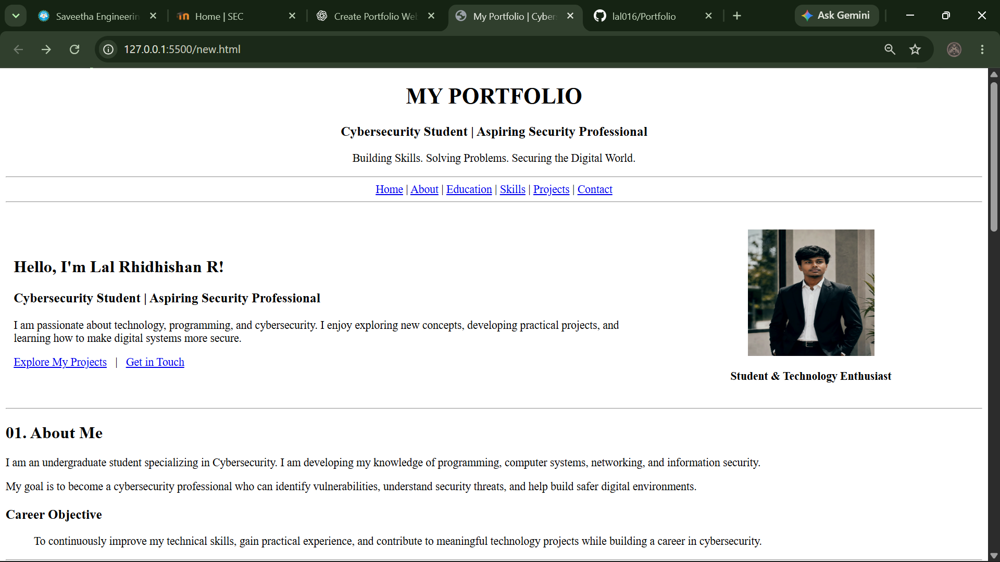
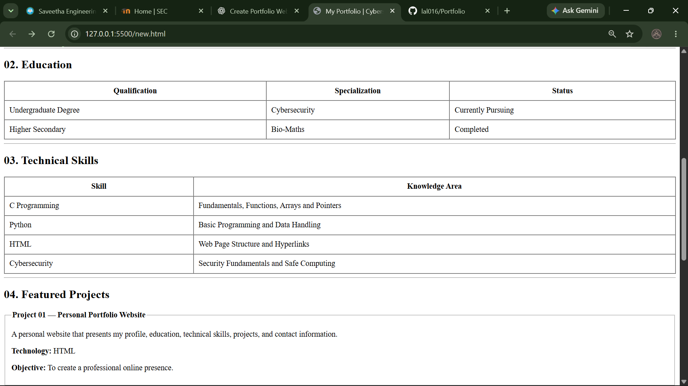
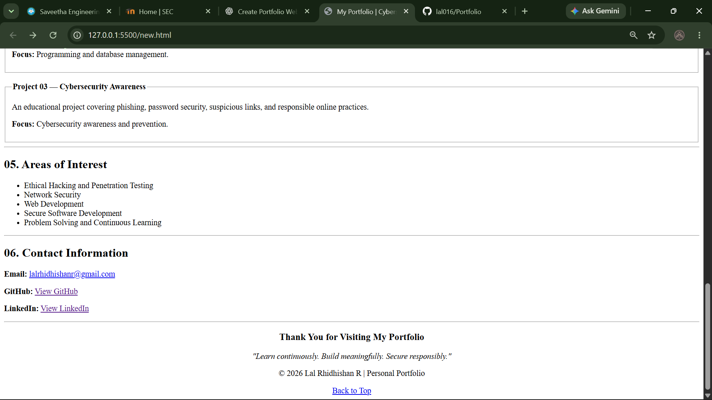

# Ex01 – Portfolio

## AIM

To design and develop a personal portfolio website using HTML to showcase personal information, educational qualifications, technical skills, projects, areas of interest, and contact details.

## ALGORITHM

**Step 1:** Create an HTML file named `index.html`.

**Step 2:** Define the basic HTML structure using the `<html>`, `<head>`, and `<body>` tags.

**Step 3:** Add a title and a heading to introduce the portfolio.

**Step 4:** Create navigation links to access different sections of the portfolio.

**Step 5:** Develop the Home section with an introduction, profile image, and professional objective.

**Step 6:** Create the About section to describe personal interests and career goals.

**Step 7:** Use HTML tables to display educational qualifications and technical skills.

**Step 8:** Create the Projects section using headings, paragraphs, and fieldset elements.

**Step 9:** Add areas of interest and contact information with appropriate HTML elements and hyperlinks.

**Step 10:** Create a footer containing a copyright notice and a Back to Top link.

**Step 11:** Save the HTML file and open it in a web browser to verify the layout and navigation links.

**Step 12:** Upload the project files to a GitHub repository for version control and online access.


## PROGRAM
```
<!DOCTYPE html>
<html lang="en">
<head>
    <meta charset="UTF-8">
    <meta name="viewport" content="width=device-width, initial-scale=1.0">
    <title>My Portfolio | Cybersecurity Student</title>
</head>
<body>
    <center>
        <h1>MY PORTFOLIO</h1>
        <h3>Cybersecurity Student | Aspiring Security Professional</h3>
        <p>Building Skills. Solving Problems. Securing the Digital World.</p>
        <hr>
        <a href="#home">Home</a>   |   
        <a href="#about">About</a>   |   
        <a href="#education">Education</a>   |   
        <a href="#skills">Skills</a>   |   
        <a href="#projects">Projects</a>   |   
        <a href="#contact">Contact</a>
        <hr>
    </center>

    <br>

    <!-- Home -->
    <table width="100%" cellpadding="10">
        <tr>
            <td width="65%" valign="middle">
                <h2 id="home">Hello, I'm Lal Rhidhishan R!</h2>
                <h3>Cybersecurity Student | Aspiring Security Professional</h3>
                <p>
                    I am passionate about technology, programming,
                    and cybersecurity. I enjoy exploring new concepts,
                    developing practical projects, and learning how
                    to make digital systems more secure.
                </p>
                <p>
                    <a href="#projects">Explore My Projects</a>
                    &nbsp; | &nbsp;
                    <a href="#contact">Get in Touch</a>
                </p>
            </td>

            <td width="35%" align="center">
                
                <p><b>Student & Technology Enthusiast</b></p>
            </td>
        </tr>
    </table>

    <hr>

    <!-- About -->
    <h2 id="about">01. About Me</h2>
    <p>
        I am an undergraduate student specializing in Cybersecurity.
        I am developing my knowledge of programming, computer systems,
        networking, and information security.
    </p>
    <p>
        My goal is to become a cybersecurity professional who can
        identify vulnerabilities, understand security threats, and
        help build safer digital environments.
    </p>

    <h3>Career Objective</h3>
    <blockquote>
        To continuously improve my technical skills, gain practical
        experience, and contribute to meaningful technology projects
        while building a career in cybersecurity.
    </blockquote>

    <hr>

    <!-- Education -->
    <h2 id="education">02. Education</h2>
    <table border="1" width="100%" cellpadding="10" cellspacing="0">
        <tr>
            <th>Qualification</th>
            <th>Specialization</th>
            <th>Status</th>
        </tr>
        <tr>
            <td>Undergraduate Degree</td>
            <td>Cybersecurity</td>
            <td>Currently Pursuing</td>
        </tr>
        <tr>
            <td>Higher Secondary</td>
            <td>Bio-Maths</td>
            <td>Completed</td>
        </tr>
    </table>

    <hr>

    <!-- Skills -->
    <h2 id="skills">03. Technical Skills</h2>
    <table border="1" width="100%" cellpadding="10" cellspacing="0">
        <tr>
            <th>Skill</th>
            <th>Knowledge Area</th>
        </tr>
        <tr>
            <td>C Programming</td>
            <td>Fundamentals, Functions, Arrays and Pointers</td>
        </tr>
        <tr>
            <td>Python</td>
            <td>Basic Programming and Data Handling</td>
        </tr>
        <tr>
            <td>HTML</td>
            <td>Web Page Structure and Hyperlinks</td>
        </tr>
        <tr>
            <td>Cybersecurity</td>
            <td>Security Fundamentals and Safe Computing</td>
        </tr>
    </table>

    <hr>

    <!-- Projects -->
    <h2 id="projects">04. Featured Projects</h2>

    <fieldset>
        <legend><b>Project 01 — Personal Portfolio Website</b></legend>
        <p>
            A personal website that presents my profile, education,
            technical skills, projects, and contact information.
        </p>
        <p><b>Technology:</b> HTML</p>
        <p><b>Objective:</b> To create a professional online presence.</p>
    </fieldset>

    <br>

    <fieldset>
        <legend><b>Project 02 — Library Management System</b></legend>
        <p>
            A system concept for organizing book records and
            simplifying library operations.
        </p>
        <p><b>Focus:</b> Programming and database management.</p>
    </fieldset>

    <br>

    <fieldset>
        <legend><b>Project 03 — Cybersecurity Awareness</b></legend>
        <p>
            An educational project covering phishing, password
            security, suspicious links, and responsible online practices.
        </p>
        <p><b>Focus:</b> Cybersecurity awareness and prevention.</p>
    </fieldset>

    <hr>

    <!-- Interests -->
    <h2>05. Areas of Interest</h2>
    <ul>
        <li>Ethical Hacking and Penetration Testing</li>
        <li>Network Security</li>
        <li>Web Development</li>
        <li>Secure Software Development</li>
        <li>Problem Solving and Continuous Learning</li>
    </ul>

    <hr>

    <!-- Contact -->
    <h2 id="contact">06. Contact Information</h2>
    <p>
        <b>Email:</b>
        <a href="mailto:lalrhidhishanr@gmail.com">
            lalrhidhishanr@gmail.com
        </a>
    </p>
    <p>
        <b>GitHub:</b>
        <a href="https://github.com/lal016">View GitHub</a>
    </p>
    <p>
        <b>LinkedIn:</b>
        <a href="https://www.linkedin.com/in/lal-rhidhishan-r-052b9437a">View LinkedIn</a>
    </p>

    <hr>

    <!-- Footer -->
    <center>
        <h3>Thank You for Visiting My Portfolio</h3>
        <p><i>"Learn continuously. Build meaningfully. Secure responsibly."</i></p>
        <p>
            &copy; 2026 Lal Rhidhishan R | Personal Portfolio
        </p>
        <a href="#home">Back to Top</a>
    </center>

</body>
</html>

```

## OUTPUT






## RESULT

Thus, a personal portfolio website was successfully created using HTML only, without CSS or JavaScript, to present personal information, education, technical skills, projects, and contact details in a structured format. The project is ready to be uploaded to GitHub.